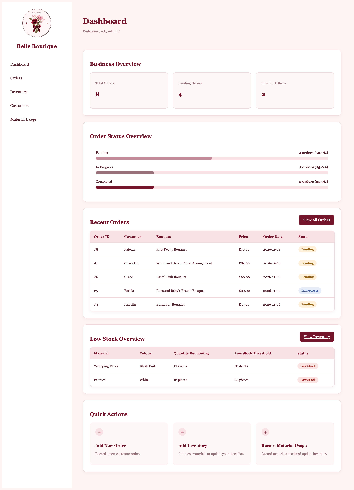
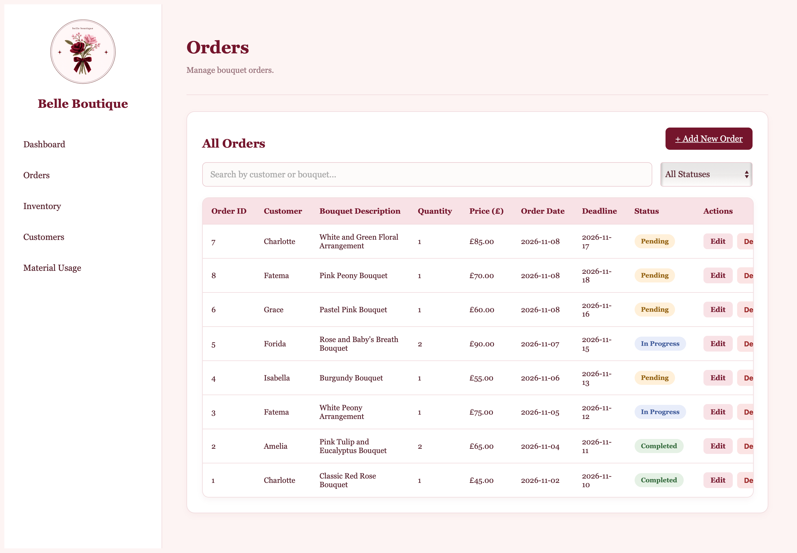
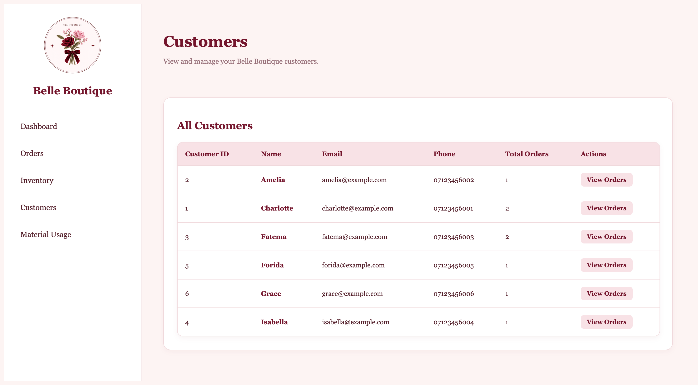
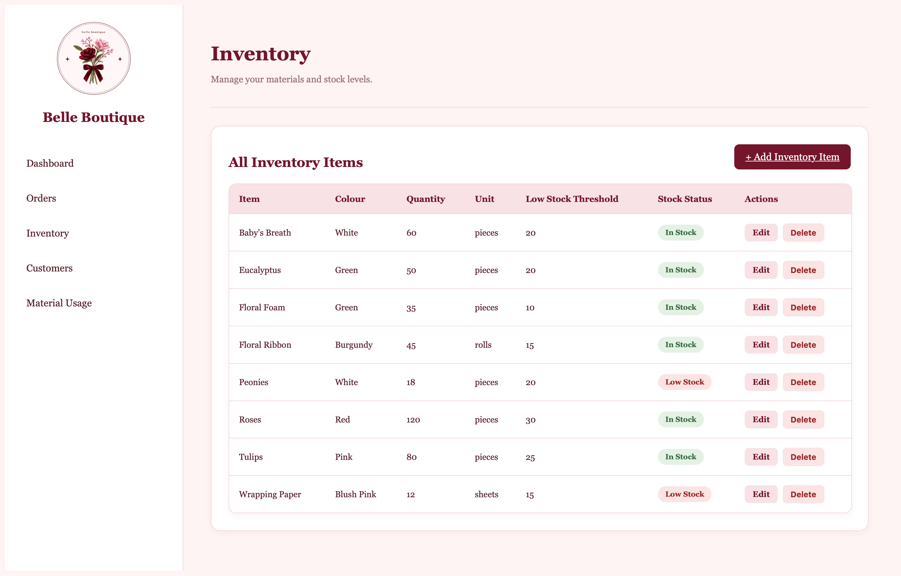
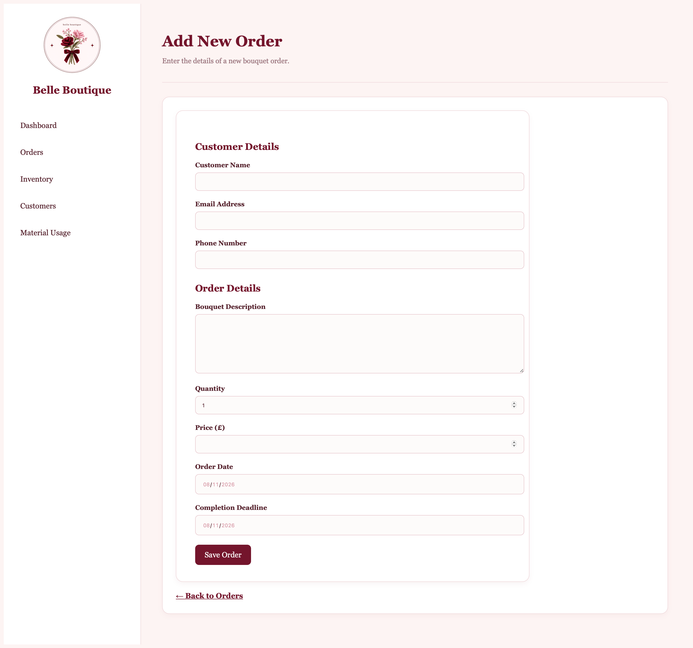
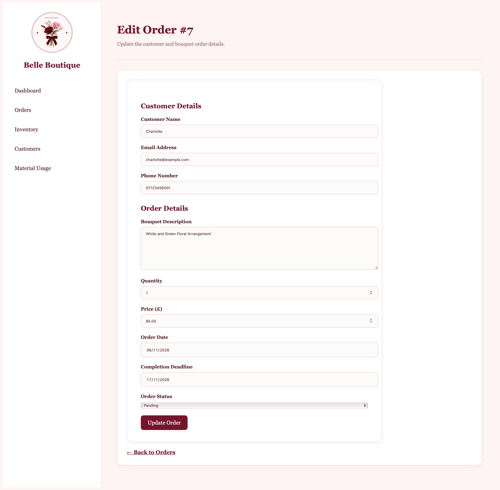
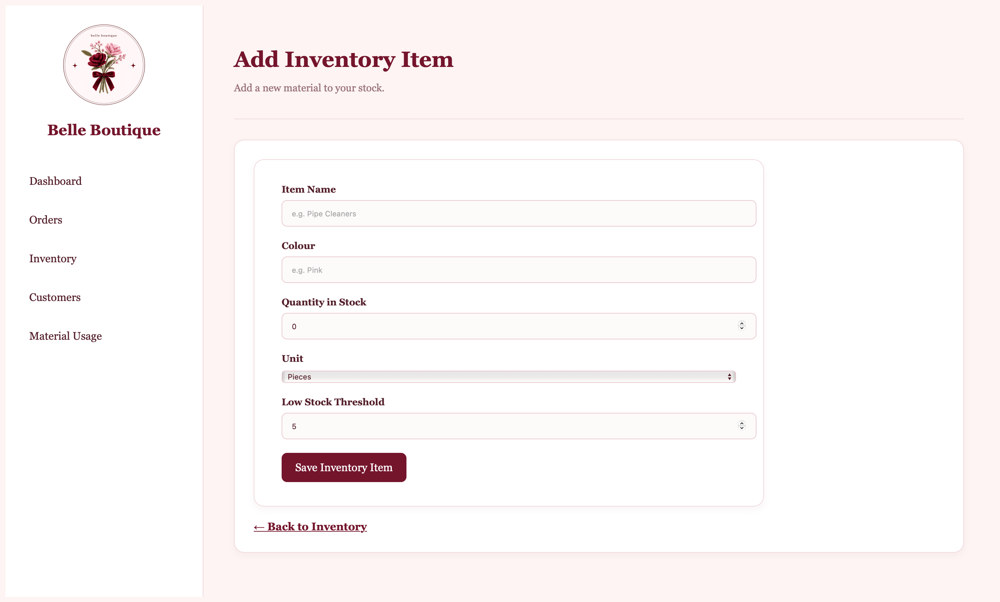
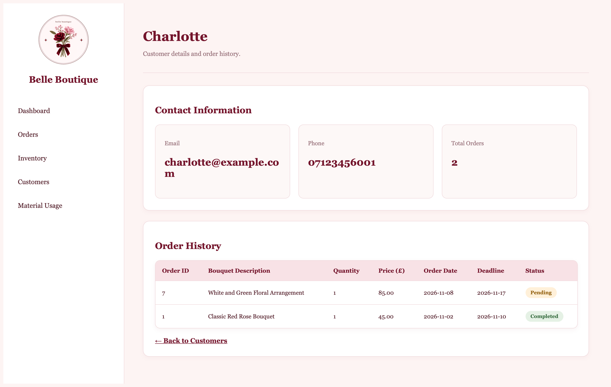
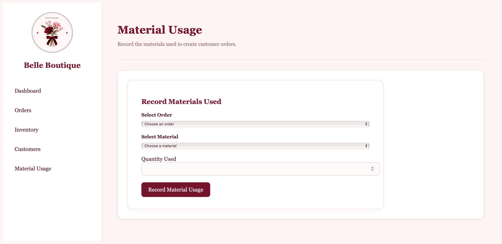
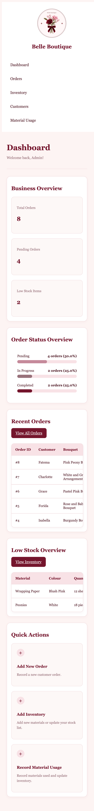

# Belle Boutique - Flower Business Management System

A web-based flower shop management system built with PHP, MySQL, HTML, CSS, and JavaScript.

Belle Boutique provides an admin dashboard for managing customer orders, customer information, inventory, and material usage. It is designed to make everyday operations easier to monitor and manage.

## Screenshots

### Desktop Views

**Dashboard**

**Order Management**

**Customer Management**

**Inventory Management**

### Management Features

**Add New Order**

**Edit Order**

**Add Inventory**

**Customer Details**

**Material Usage Tracking**

### Responsive Design

**Mobile Dashboard**

## Features

- **Dashboard:** View order statistics, pending orders, low-stock alerts, and recent orders.
- **Order Management:** Create, view, edit, and delete customer orders.
- **Customer Management:** View customer information and individual order histories.
- **Inventory Management:** Add, edit, delete, and monitor inventory items.
- **Material Usage Tracking:** Record materials used for orders and automatically update stock quantities.
- **Search and Filtering:** Search orders and filter them by status.
- **Data Validation:** Validate user input and prevent invalid information from being submitted.
- **Security:** Use prepared SQL statements, input validation, and CSRF protection for forms and actions.
- **Responsive Design:** Access the dashboard across desktop and mobile screen sizes.

## Technologies Used

- **PHP** – Server-side development and application logic.
- **MySQL** – Relational database for storing customers, orders, and inventory.
- **MySQLi** – Database connectivity and prepared SQL statements.
- **HTML5** – Page structure.
- **CSS3** – Styling and responsive layouts.
- **JavaScript** – Client-side interactions, search, filtering, and dashboard chart calculations.
- **Git and GitHub** – Version control and project management.

## Installation and Setup

### Prerequisites

- MAMP or another local PHP development environment.
- PHP and MySQL.
- A web browser.

### Setup Instructions

1. Clone or download this repository.
2. Place the `belle_boutique` project folder inside your local server's web directory (for example, MAMP's `htdocs` folder).
3. Start Apache and MySQL using MAMP.
4. Open phpMyAdmin in your browser.
5. Create a new database named `belle_boutique`.
6. Select the newly created database and open the **Import** tab.
7. Choose the `belle_boutique.sql` file located in the project's root folder.
8. Click **Import** or **Go** to import the database.
9. Open `includes/db_connect.php` and update the database connection settings to match your local MySQL configuration.
10. Open the application in your browser:

   `http://localhost/belle_boutique/`

### Database Configuration

The database connection is configured in:

`includes/db_connect.php`

Update the following settings if your local environment uses different credentials:

- Host
- Port
- Database name
- Username
- Password

**Note:** This project is currently configured for local development. Do not upload real database credentials to GitHub. Use secure configuration for database credentials before deploying the application to a live server.

## Future Improvements

- Add user authentication and role-based access.
- Implement order notifications and reminders.
- Add sales reports and analytics.